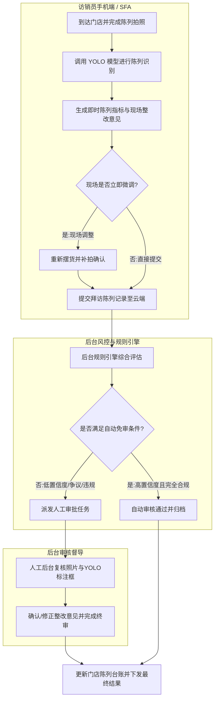
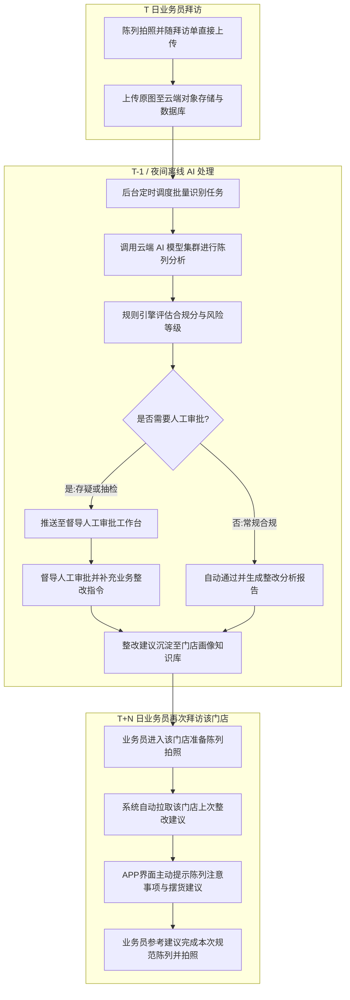
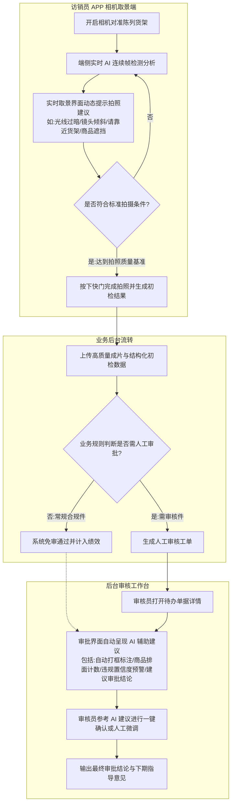

# 陈列识别三种业务流转场景（Mermaid流程图设计）

## 沟通背景

业务针对门店陈列识别规划了三种不同时效性与交互模式的应用场景，需绘制清晰的业务流转图（Mermaid）进行梳理与方案论证：
1. **场景一：拍后直接 YOLO 识别 + 现场整改意见 + 后台按需审批闭环**；
2. **场景二：拍后上传 + 后台 T+1 批处理 AI 识别 + 建议沉淀并在下次拍照时给建议**；
3. **场景三：拍照中实时 AI 识别与拍照建议 + 拍照完成后按需审批 + 审批过程中提供 AI 辅助建议**。

---

## 场景一：拍后即验快速反馈流（即时性整改）

- **业务定位**：业务员在门店拍照后立即获得识别与整改指令，现场可快速补拍或微调。
- **流程图**：

---

## 场景二：后台 T-1 批处理与周期性建议流（低频离线闭环）

- **业务定位**：常规拍照即上传，后台夜间或周期性跑批统一识别，节约实时算力；将历史整改建议带入下一次周期拜访。
- **流程图**：

---

## 场景三：实时取景引导与审中 AI 智辅流（端侧沉浸交互 + 智审双轮驱动）

- **业务定位**：拍摄过程中端侧实时引导防止废片，拍照完成后后台审批界面提供 AI 辅助决策，最大化人机协同效率。
- **流程图**：

---

## 三种场景综合对比

| 对比维度 | 场景一：拍后即验快速反馈流 | 场景二：后台 T-1 批处理与下期建议流 | 场景三：实时取景引导与智审双轮流 |
| :--- | :--- | :--- | :--- |
| **交互时效** | 拍照完成后数秒内出结果 | T+1 隔天出结果，下次拜访闭环 | 取景中毫秒级（30 FPS）实时交互 |
| **纠偏时机** | 拍照后现场纠偏 | 下个拜访周期（天/周级）纠偏 | 按下快门前即时预防，杜绝废片 |
| **算力部署** | 端侧轻量 YOLO 或云端快速接口 | 云端定时批量离线 GPU 运算 | 端侧轻量模型 + 云端多模态复合 |
| **审批角色** | 规则自动判定 + 人工按需兜底 | 离线自动分类 + 督导批处理复核 | 规则分流免审 + 审中 AI 实时辅助 |
| **适用阶段** | 业务试点与初期推广期 | 成本敏感、网络弱且无实时强需求期 | 全面数字化成熟期与极致体验期 |

