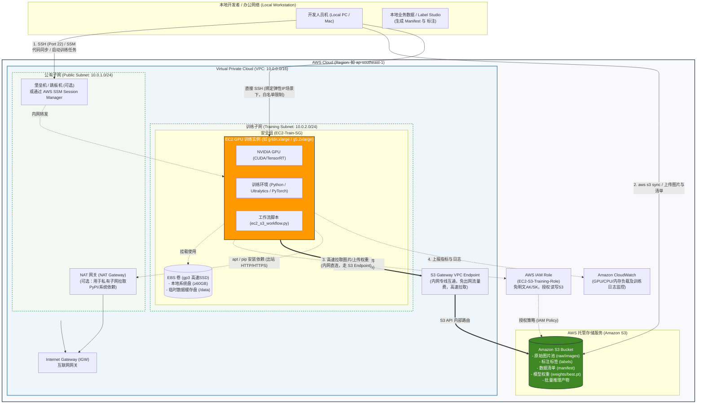
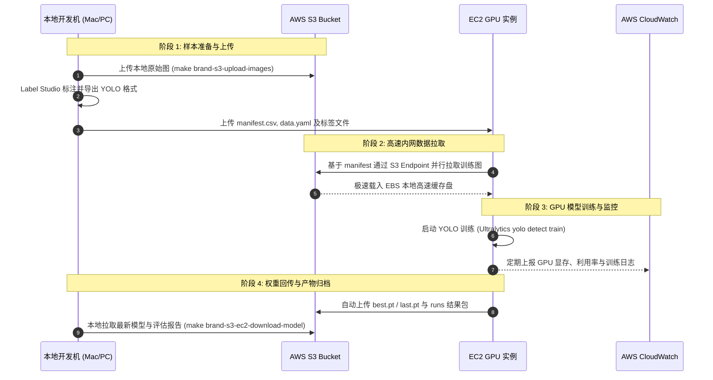

# AWS EC2 YOLO 模型训练网络拓扑图与架构设计说明

## 一、背景与目标

在 YOLO 陈列识别系统中，训练数据（成千上万张高分辨率门店货架/陈列图片）通常体量较大，且标注和微调工作频繁。本项目采用 **“本地清洗与标注管理 + S3 对象存储中转 + AWS EC2 GPU 实例弹性能量训练”** 的混合云架构。

为了满足模型训练的高吞吐、数据安全性以及云资源成本控制（避免高昂的跨网络公网流量传输费用与 NAT 流量网关费用），特设计并固化本套 AWS EC2 训练网络拓扑架构。

---

## 二、AWS EC2 训练网络拓扑图 (Mermaid)

---

## 三、网络分层与核心组件规划

| 组件名称 | 网络位置 | 规划与功能说明 |
| :--- | :--- | :--- |
| **VPC (虚拟私有云)** | AWS Cloud (`10.0.0.0/16`) | 逻辑隔离的云上私有网络，提供独立的 IP 寻址空间与子网划分能力。 |
| **S3 Gateway Endpoint** | VPC 路由级终结点 | **核心关键组件**：EC2 实例通过内网专线高速读写 S3。**不消耗公网带宽、免收公网流量传输费用、延迟极低**。 |
| **训练子网 (Training Subnet)**| 私有子网 (`10.0.2.0/24`) | 部署 GPU 训练实例。不分配公网 IP，通过安全组和路由表进行严格访问控制。 |
| **公有子网 (Public Subnet)** | 公有子网 (`10.0.1.0/24`) | 部署 NAT 网关和（可选）跳板机/堡垒机，负责受控出网和运维接入。 |
| **EC2 GPU 训练实例** | 训练子网 | 推荐选型： - `g4dn.xlarge` (1x T4 16GB, 性价比高，适合轻量调优) - `g5.2xlarge` (1x A10G 24GB, 适合 `imgsz=960/1280` 大图训练) |
| **IAM 实例角色** | AWS IAM | 绑定到 EC2 实例（Instance Profile），免除在 EC2 配置文件中写入明文 AK/SK，遵循最小权限访问 S3。 |
| **EBS 卷 (gp3)** | 挂载于 EC2 | 系统盘建议 ≥ 60GB；训练缓存盘配置更高 IOPS（如 3000）和吞吐量（如 250MB/s），用于在本地快速循环加载图片。 |
| **NAT 网关 & IGW** | 公有子网 | 用于私有子网中的 EC2 出站拉取 PyPI 依赖、操作系统更新及 HuggingFace/GitHub 权重基底。 |

---

## 四、安全组 (Security Group) 规则设计

严格遵循**最小权限原则 (Principle of Least Privilege)**：

### 1. 入站规则 (Inbound Rules) - `EC2-Train-SG`
| 协议 | 端口范围 | 源地址 (Source) | 用途说明 |
| :--- | :--- | :--- | :--- |
| **TCP** | `22` | 本地办公网络固定外网 IP (`x.x.x.x/32`) 或 堡垒机内网 IP | **严禁配置 `0.0.0.0/0`**。若使用 AWS SSM Session Manager，甚至可以完全关闭 22 端口入站。 |
| **TCP** | `6006` (可选) | 本地办公网络固定 IP | TensorBoard 训练可视化面板（按需临时开启）。 |

### 2. 出站规则 (Outbound Rules) - `EC2-Train-SG`
| 协议 | 端口范围 | 目的地址 (Destination) | 用途说明 |
| :--- | :--- | :--- | :--- |
| **HTTPS (TCP)** | `443` | `pl-xxxxxx` (AWS S3 Prefix List) | 经由 S3 VPC Endpoint 高速读写 S3 存储桶。 |
| **HTTPS (TCP)** | `443` | `0.0.0.0/0` (经由 NAT 网关) | 下载 Python pip 包、CUDA 驱动更新或预训练权重。 |
| **HTTP (TCP)** | `80` | `0.0.0.0/0` (经由 NAT 网关) | 操作系统包管理器 (apt/yum) 更新源。 |

---

## 五、端到端数据流与运维工作流

结合本项目的自动化脚本（如 `scripts/cloud/ec2_s3_workflow.py` 与 `Makefile` 命令），业务流转分为四个阶段：

1. **阶段 1：数据准备与分发**
   - 开发者本地将图片增量上传到 S3：`make brand-s3-upload-images`。
   - 本地 Label Studio 基于 S3 代理完成标注，生成 YOLO 标注标签与 `ec2_image_manifest.csv`。
   - 上传元数据到 EC2：`make brand-s3-ec2-upload-manifest`。
2. **阶段 2：EC2 内网高速拉取**
   - EC2 实例通过绑定的 **IAM Role** 免密鉴权，读取 S3 清单。
   - 通过 **S3 Gateway Endpoint** 在内网以数十至数百 MB/s 的速度拉取图片至 EBS 挂载盘（`datasets/s3/<dataset_name>/images`）。
3. **阶段 3：训练执行与监控**
   - 执行 `make brand-s3-ec2-train`，调用本地 GPU 满血运行 100~200 Epochs。
   - 训练日志与系统性能可同步采集至 CloudWatch。
4. **阶段 4：权重归档与回传**
   - 训练完成后，EC2 工作流脚本将 `runs/train/<run_name>/weights/best.pt`、混淆矩阵、F1曲线等评估产物同步回传至 S3 存储桶的归档目录。
   - 开发者本地通过 `make brand-s3-ec2-download-model` 直接获取产物进行端侧部署或进一步微调。

---

## 六、生产环境最佳实践与成本优化建议

1. **避免跨公网流量资费**：
   - 务必配置 **S3 Gateway VPC Endpoint**。若直接通过公网访问 S3，不仅速度受限于 NAT/公网带宽，还会产生不菲的 AWS Data Transfer Out 费用。
2. **优先选用竞价实例 (Spot Instance)**：
   - 对于非紧急或具备 Checkpoint 机制（YOLO 原生支持 `resume=True`）的离线训练任务，使用 EC2 Spot 实例可节省 **60%~80%** 的算力成本。
3. **IAM 实例角色替代明文秘钥**：
   - 严格禁止在 `config/brand_s3_ec2.local.yaml` 或 EC2 的 `~/.aws/credentials` 中固化高权限明文 AK/SK，统一采用 IAM Instance Profile。
4. **定时自动启停与无服务器管控**：
   - 训练任务脚本结束后可执行自动关机逻辑（如 `sudo shutdown -h now`），搭配 Auto Stop 机制，避免 GPU 闲置扣费。
